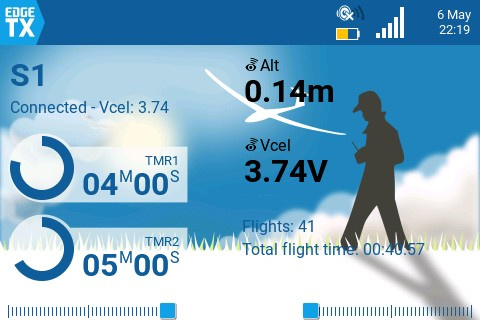

  <picture>
    <source media="(prefers-color-scheme: dark)" srcset="https://raw.githubusercontent.com/WingFlight/wingflight-landing-page/master/logos/wf_logo_dark_white.svg">
    
  </picture>

# Wingflight Lua Scripts for EdgeTX

These scripts configure a [Wingflight](https://github.com/WingFlight/wingflight-firmware) flight
controller from an EdgeTX or OpenTX transmitter: change settings at the field, hear what an
adjustment did, and see telemetry and flight statistics in widgets. Wingflight is open-source
flight controller firmware for fixed-wing aircraft.

**[Documentation](https://doc.wingflight.org)** ·
**[Releases](https://github.com/WingFlight/wingflight-lua-edgetx/releases)** ·
**[Discord](https://discord.gg/aEyyAJTXRw)**

For FrSky Ethos radios, use the [Wingflight Lua suite for Ethos](https://github.com/WingFlight/wingflight-lua-ethos-suite).

## Requirements

- EdgeTX 2.5.0 or OpenTX 2.3.12 or later transmitter firmware
- A receiver supporting remote configuration:
  - a FrSky Smartport or F.Port receiver, _or_
  - a Crossfire v2.11 or newer receiver, _or_
  - an ELRS 2.0.1 or newer receiver

> [!IMPORTANT]
> If you're using ELRS, make sure to set the baudrate to 1.87M or higher in the *Hardware* menu of your transmitter.

## Installation

The [Wingflight EdgeTX/OpenTX Lua Updater](https://github.com/WingFlight/wingflight-lua-edgetx-updater/releases)
downloads the scripts and copies them to the radio's SD card for you. To install by hand, download the latest version from [GitHub](https://github.com/WingFlight/wingflight-lua-edgetx/releases/) and copy the contents of the `SCRIPTS` folder to your transmitter. You will know that you've done it correctly when you find the `wf.lua` file located in the `/SCRIPTS/TOOLS` directory. Plus, you should now see *Wingflight* listed in the *Tools* menu of your transmitter. Also, you should be able to see the *WF Tool* and *WF Stats* widgets if you have a color radio.

### Copying the SCRIPTS folder

USB Method

1. Connect your transmitter to a computer with an USB cable
2. Open the new drive on your computer
3. Unzip the file and copy the `SCRIPTS` folder to the root the new drive
4. Eject the drive
5. Unplug the USB cable

SD Card Method

1. Power off your transmitter
2. Remove the SD card and plug it into a computer
3. Unzip the file and copy the `SCRIPTS` folder to the root of the SD card
4. Eject the SD card
5. Reinsert your SD card into the transmitter
6. Power up your transmitter

If you copied the files correctly, you can now go into the *Tools* menu on your transmitter and access the *Wingflight* tool. The first time you run the script, a message 'Compiling...' will appear in the display before the script is started. This is normal and is done to minimise the RAM usage of the script.

## Usage

Start the tool using the *Tool* menu of your transmitter or by setting the *WF Tool* widget to *Full Screen* mode. Feel free to look around, changes will only be saved if you explicitly select *Save*:
- On color radios there is a *Save* button in the upper right corner.
- On black and white radios, select the *Save* option after long pressing the wheel/roller.

For more information, see the [Wingflight documentation](https://doc.wingflight.org).

## Background script
The optional background script `wfbg.lua` features *Real Time FC Clock synchronization*, the *Adjustment Teller* and *CRSF/ELRS custom telemetry*.
- RTC synchronization will send the time of the transmitter to the flight controller. The script will beep if RTC synchronization has been completed. Blackbox logs and files created by the FC will now have the correct timestamp.
- *CRSF/ELRS custom telemetry* enables all available Wingflight telemetry sensors when using ELRS.
- The *Adjustment Teller* will [tell you](https://www.youtube.com/watch?v=rbMiiWhzhqI) what adjustment you just made (the video shows the Rotorflight scripts). It supports all adjustments except profile adjustments.

There are two ways to run the background script:
1. Either configure the *WF Tool* widget. This only works on color radios running EdgeTX.
2. Or configure `wfbg` to run as a special or global function in EdgeTX/OpenTX.

### 1. Configure the *WF Tool* widget

If you have a color radio running EdgeTX 2.11 or higher, then you can use the *WF Tool* widget. Running this widget has several benefits:
- It will automatically show the name of the connected model.
- *WF Tool* can also always display one sensor value of your liking. I like *Vcel* (cell voltage) to be displayed always, so I don't completely exhaust my batteries while tuning.
- *WF Tool* defines an API that can also be used by other widgets, which makes programming Wingflight widgets easier. The *WF Stats* widget for example uses the *WF Tool* API, and displays/updates flight statistics.
- You don't need to configure a function for running the background script anymore.

In the image below you can see the *WF Tool* widget in the upper left part, while the *WF Stats* widget sits in the lower right part of the screen.

Here's a video that explains [how to set up the widget](https://www.youtube.com/watch?v=t72pQoBngGs). It was recorded for the Rotorflight scripts these are forked from; the steps are the same, with *WF* in place of *RF*.

### 2. Or run the background script as a function
In OpenTX, configure your special function as follows to run the script automatically as soon as the model is selected ('ON').

On EdgeTX, make also sure to set *Repeat* to *On*:

## Adjustment Teller

The *Adjustment Teller* can be enabled under Settings > Wfbg Options > Adjustment Teller. The teller uses telemetry for getting the adjustment function and value:
- S.port/F.port: the telemetry sensors 5110 and 5111 should be available. Discover or add them if they aren't.
- CRSF: the telemetry sensor FM should be available. Also do a `set crsf_flight_mode_reuse = ADJFUNC` in the CLI and `save`.
- CRSF/ELRS custom telemetry: make sure you include the *Adjustment Function* sensor.

> [!IMPORTANT]
> Some black & white radios (e.g. the Jumper T-LITE running EdgeTX 2.11) don't have enough memory for running both the *Adjustment Teller* and *CRSF/ELRS custom telemetry*. The user interface will then randomly freeze.

## Building from source on Linux

- Be sure to have `make` and `luac` in version 5.2 installed in the path.
- Run `make` from the root folder.
- The installation files will be created in the `obj` folder. Copy the files to your transmitter as instructed in the [Installation](#installation) section as if you unzipped from a downloaded file.

## Contributing

Wingflight is a community project. You can help by:

* testing new versions and [reporting bugs](https://github.com/WingFlight/wingflight-lua-edgetx/issues)
* helping other pilots on [Discord](https://discord.gg/aEyyAJTXRw)
* translating the scripts, or keeping a translation up to date
* fixing bugs and adding features

## Origins

Wingflight is open source and free of charge, with no warranty.

These scripts are a fork of the [Rotorflight Lua scripts for EdgeTX](https://github.com/rotorflight/rotorflight-lua-scripts).
Thank you to everyone who contributed along the way.
